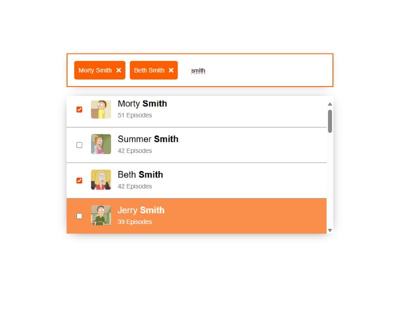
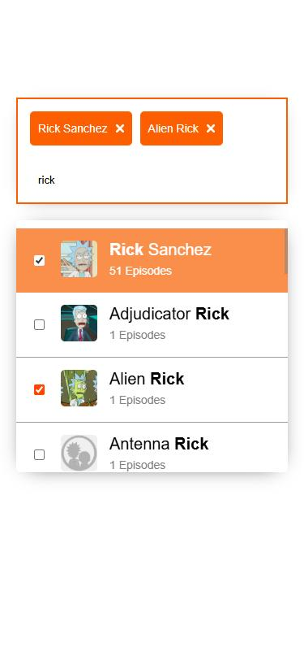

# Rick and Morty Character Picker

A multi-select search box for Rick and Morty characters, built with React, TypeScript, Redux Toolkit and Vite.

<p align="center">
  
  
</p>

## Features

- **Search and filter.** Characters come from the public [Rick and Morty API](https://rickandmortyapi.com/) as you type, and the matching part of each name is shown in bold.
- **Multi-select.** Pick as many characters as you like, with the mouse or the keyboard. Selections stay when you search again, and each one can be removed from its chip.
- **Keyboard navigation.** ↓ and ↑ move through the list and wrap around at both ends, Enter selects or unselects the active character, Backspace in an empty box removes the last chip, and Escape closes the list. The active item scrolls into view.
- **Two custom hooks.** `useKeyboardNavigation` drives any list from a text input with the keyboard, and `useOnClickOutside` closes the list when you click elsewhere.
- **Debounced, cancellable search.** A request goes out 300 ms after typing pauses, and a new search cancels the previous one, so a slow, older response can never replace newer results.
- **Responsive.** The picker fits phone screens without horizontal scrolling.

## Run it

Requires Node.js 18 or newer.

```bash
npm ci
npm run dev
```

Then open http://localhost:5173. `npm run build` type-checks and builds the app, and `npm run lint` runs ESLint.

## How it works

- `src/hooks/useKeyboardNavigation.ts` owns the active index, the wrap-around and the scrolling, and calls back for Enter, Backspace and Escape. It knows nothing about Redux or about characters, so it works with any list.
- `src/features/` holds the Redux slice (search text, open state, selected characters) and the search thunk. The thunk passes Redux Toolkit's abort signal to axios and turns the API's 404 for "no match" into an empty result.
- Selections are stored by character id. The API has several different characters with the same name (four Morty Smiths, for example), and each one can be selected on its own.
- When the API finds no match it answers 404, which the app shows as "No characters found." rather than as a network error.
